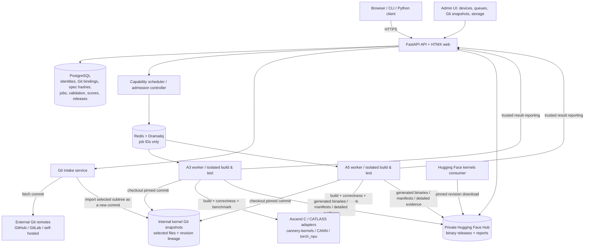
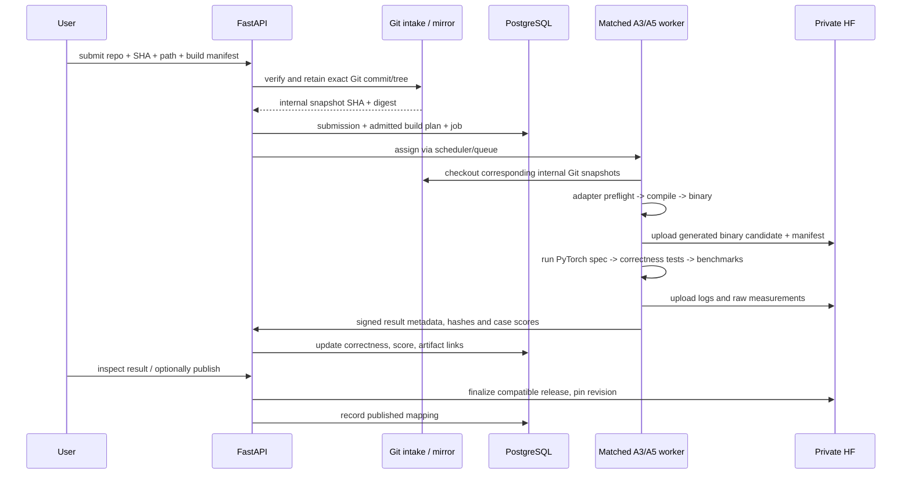

# CANNery — System Architecture

Status: revised PoC architecture · 2026-11-09

This document describes deployed services, data ownership, exactly where source and artifacts land, copies, admission, build execution and distribution. See [Design](design.md), [Implementation](implementation.md), [Roadmap](roadmap.md) and [User Story](user-story.md).

## 1. Non-negotiable contracts

1. **All user-authored source code comes from Git.** Registration and submission require repository URL (or saved source binding), full commit SHA and subdirectory. No archive/local-folder source upload endpoint.
2. **Git is the code store.** The external repository is the development remote, and CANNery retains **only admitted source subtrees and their CANNery submission history** in per-kernel internal Git repositories. These are synthetic snapshot commits, not mirrors of upstream repository history. Source tarballs are not published in HF.
3. **Binaries are generated by CANNery admission.** A submission provides reproducible build instructions. CANNery builds in a capability-matched worker, validates against the frozen PyTorch spec, and publishes generated binary packages and manifests into our private Hugging Face organization.
4. **PoC builders:** `ascendc` and `catlass`. Future adapter IDs: `triton`, `pypto`. Device dimensions: A3, A5. A submission cannot bring an arbitrary executable build script into the trusted coordinator: build descriptions use a typed, allowlisted adapter contract.
5. **Frozen specification:** spec YAML, PyTorch reference and case generator are read from an immutable Git commit/tree and bound to content digests. A changed spec produces a new version. Implementations can evolve by submitting **only a new commit SHA** against a saved source binding.
6. **Results:** keep per-case median µs, p95, correctness/error, pinned baseline and geometric mean speedup. Global best includes only validated, explicitly published releases; rankings and history remain separate per device and tolerance profile.
7. **Source and binary distribution differ:** source resolution returns a Git URL + pinned commit + path (and optional read access to the internal snapshot repository); binary resolution returns a pinned HF revision. HF `kernels` loading requires the Ascend runtime extensions in `cannery-kernels`.

## 2. Logical services



Coordinator access to PostgreSQL and upload credentials is **not** granted to arbitrary user Python. Executors run in separate sandboxes; a trusted worker coordinator validates returned records and writes results.

## 3. Deployable service inventory

| Service | Placement | Function | State |
|---|---|---|---|
| Reverse proxy | Control-plane VM | TLS and API/Web routing | TLS config |
| FastAPI API/Web | Control-plane VM | registration, submissions, auth, leaderboard, release resolution, user ETA, admin UI | PostgreSQL |
| Git intake + subtree snapshotter | Internal CPU service/volume | authorized external Git fetch; resolve SHA; import selected paths as snapshot commits; verify tree/path and capture digests | small per-kernel Git repositories and PG mapping |
| Scheduler | Control plane | worker capabilities, job eligibility, leases, timeouts, ETA | PostgreSQL |
| Redis + Dramatiq | Control plane | notification and job dispatch | transient messages only |
| Worker coordinators | One per A3/A5 host | advertise capability, fetch job data, launch sandbox, upload binary/evidence and report results | local scratch/cache only |
| Builder adapters | Isolated worker processes | deterministic build of Ascend C or CATLASS input into loadable artifact | generated binary until upload |
| Test/benchmark executor | Isolated NPU process | run PyTorch reference and compiled candidate; measure error/latency | raw measurements until upload |
| Artifact adapter | library in API/worker coordinator | upload/download pinned HF binary and evidence | HF repositories |
| PostgreSQL | Control plane | authoritative metadata, Git refs, frozen spec identity, job state, measured results, publication | backed-up DB volume |
| Kernel snapshot store | internal persistent storage | Git commits containing only admitted kernel/spec files and declared dependencies | backed-up per-kernel Git repositories |
| HF private storage | managed external provider | binaries, loader manifests, build attestations, logs, raw case timings | pinned HF revisions |
| Admin | role-gated FastAPI routes | device, queue, Git snapshots and HF health, retention | no separate user-facing service |

Use Docker Compose for control-plane components and independently deployed accelerator workers. A CPU-only host can run Git intake and non-device static checks. A3/A5 compilation may run without NPUs where toolchain permits, but correctness and device benchmarking require the matching NPU.

## 4. Storage ownership and copies

| Data | First landing | Canonical retention | Temporary copies |
|---|---|---|---|
| User source (reference, cases, implementation, YAML, build manifest) | External Git remote | **Per-kernel Git snapshot repository**, internal commit mapped to upstream SHA/tree/path | restricted intake checkout; worker sandbox checkout |
| External Git URL, full SHA, repo subpath, file/tree digest | API | PostgreSQL | worker job descriptor |
| Frozen spec identity and normalized immutable YAML metadata | API after Git verification | PostgreSQL digests, pinned internal snapshot commit | spec files checked out from Git on validator |
| Build configuration and toolchain requirement | pinned Git manifest | Git for author input; normalized/validated build plan in PostgreSQL | worker executable job plan |
| Generated binaries + loader glue + build manifest | build worker scratch | **Private HF artifact repository**, pinned revision and checksum in PG | worker scratch; consumer HF cache |
| Correctness / benchmark summary, profile outcome and score | isolated evaluator | PostgreSQL | web/API response |
| Detailed raw timing, logs and build attestation | worker staging | Private HF storage | worker scratch |
| Dispatch payload | scheduler | PostgreSQL job record | Redis carries job ID |
| Device capabilities and active leases | worker registration | PostgreSQL | scheduler local cache |
| User-consumed binaries | HF download | HF is source of published binaries | `~/.cache/huggingface` or configured local cache |

**No user source code is uploaded to Hugging Face**. Loader packages may contain *generated* Python entrypoint glue/metadata required by the runtime; such glue must not be mistaken for the author's primary source checkout.

**Snapshot retention:** CANNery imports only the accepted folder and explicitly declared dependency paths into an internal per-kernel Git repository. It makes a new commit for each accepted revision, recording the upstream URL, full commit SHA, original tree hash, source path and content digest in PostgreSQL and Git commit metadata. No upstream parent objects or unrelated history are retained. Protect accepted internal commits from garbage collection and back up the snapshot repositories. If the remote disappears, reproducible builds use the internal snapshot; if needed files are outside the selected path, they must be declared in the manifest or the build is rejected.

## 5. Git source registration and revisions

Registration of a new operator accepts `repo + full commit + spec path`. A trusted intake process checks out `cannery.yaml`, `reference.py`, `cases.py` from the Git tree, validates safety and schema, and binds `team/fa_xxx@spec-v1` to immutable Git tree/digests. It mirrors the commit and creates the spec record. No local upload and no HF spec archive.

An implementation submission accepts a Git URL/commit/path (or existing repository binding), specification ID, target device/language and typed build manifest. The **source binding** stores Git repo, path, entrypoint, spec version, device and language. A later `cannery revise SUBMISSION --commit SHA` inherits all other fields but creates a brand-new immutable submission/job. A changed PyTorch specification can only be registered as a new spec version.

Git refs such as branches/tags may assist discovery, but are resolved to a full commit at admission; storage identities never point at floating refs. Authentication for private remotes uses short-lived scoped tokens/deploy credentials stored in a secrets manager.

## 6. Build during admission

Submission becomes `received` only after Git availability, manifest schema and spec binding checks pass. Then the system schedules its build as the first executable validation stage. A successful build produces a **binary candidate**, not a published release; correctness testing follows before any global publication eligibility.



A build failure is a **failed admission/validation job** with logs. It never creates a globally eligible release. A successful build followed by correctness failure retains a private candidate binary for debugging under a retention policy, but does not publish it.

### 6.1 Build contract

Every implementation Git path contains `submission.yaml` and an adapter-specific build definition. CANNery owns and versions adapter logic. No privileged free-form `build.sh` executed by the coordinator.

```yaml
schema_version: 1
kernel: team/fa_xxx
spec_version: 1
implementation:
  device: a5
  language: catlass
  entrypoint: kernel.py:forward
  build:
    adapter: catlass
    inputs: [kernel.py]
    artifact: fa_xxx_a5
    options:
      optimization: release
validation:
  requested_rtol: 0.001
  requested_atol: 0.0001
```

The adapter returns:
```text
build(checked_out_git_tree, manifest, toolchain, target)
 -> {binary_files, runtime_entrypoint, toolchain_fingerprint, abi_constraints,
     build_logs, content_digests}
```

For `ascendc`, the adapter compiles and links into the agreed host-callable library or loader package using pinned CANN toolchains. For `catlass`, the adapter uses its supported Python compile/JIT path in a controlled **ahead-of-publication build** and exports its compiled loadable artifact plus necessary runtime glue. Some shapes/dtypes or specialization modes may only support JIT at invocation: the PoC must declare and test its supported specialization set, reject unsupported cases, and must not advertise a purely lazy JIT kernel as a fully prebuilt binary. Details must be established against actual CATLASS build/export APIs.

Future adapters `triton` and `pypto` implement the same contract with language-specific toolchain and runtime metadata. These are **not in PoC acceptance**. PyPTO is distinct from PTO-DSL; confirm and pin the intended PyPTO toolchain before adding the adapter.

## 7. Binary packaging, HF and publication

The artifact manifest records source Git URL/commit/tree digest, immutable spec ID/digest, build adapter/version, CANN and torch_npu requirements, device A3/A5, language, input specialization, SHA-256 binaries, exported Python callable ABI and validation report. The published HF repository/revision must be compatible with `cannery-kernels`' extended Hugging Face kernel loader.

HF `kernel` repo type is preferred for runtime releases, subject to organization permissions; use other private repo types for staging builds/reports if necessary. The platform indexes exact HF **commit SHAs**, not mutable branches. Publication is two-step across HF and DB: upload/verify content then atomically update PostgreSQL visibility and mapping; a reconciler handles orphans.

Publication is explicit after correctness and complete benchmarks. Published results are tolerance-profile constrained and ranked only within the same device/spec/suite/environment cohort. Each device history shows a single cumulative best-so-far step series with language-colored record markers.

## 8. Download and execution

For source inspection, `cannery source team/fa_xxx --revision r002` returns (or `git clone`s) the Git URL + immutable SHA + path; it does **not** download source from HF. Access to private source remains governed by Git permissions or explicitly authorized internal Git snapshots access.

For execution, `cannery get` resolves binary variants against the local A3/A5, CANN, Python and torch_npu environment; `--no-detect` requires explicit selection. It returns a **pinned HF kernel repository revision**. `get_kernel(... revision=<sha>, backend="cann", ...)` is the proposed Ascend-enabled `cannery-kernels` integration; it must be tested and built before claiming support.

## 9. Reliability, security and infrastructure

- External Git intake restricts allowed schemes/hosts/IPs, resolves full SHAs, limits clone/submodules/LFS size, verifies path confinement and hashes imported files; no Git hooks or arbitrary scripts run in privileged intake.
- Sandbox untrusted PyTorch references and build inputs, protect worker credentials, restrict network, mount only read-only Git checkout into execution containers and use quota/time limits.
- Deduplicate identical file blobs across internal Git snapshots; deduplicate binary artifacts by content hashes where permitted.
- On worker crash, recover durable job/lease from PostgreSQL and retry idempotently. On build failure, retain logs. On HF failure, leave job pending publication, not globally visible.
- Backup PostgreSQL **and internal Git snapshots**. HF holds binary artifacts externally; keep independent release metadata backups and consider mirrored binary storage for production.
- Initial capacity: 8 vCPU / 32 GB control plane; 100–200 GB SSD for DB/log/cache **plus an initial 20–50 GB persistent Git snapshots volume (adjust by measured usage)**; A3 and A5 worker hosts with 100+ GB scratch each; private HF binary/report budget ~100–500 GB (actual usage measured). Optional CPU Git intake host.

## Git subtree snapshot policy

For each accepted registration or revision, a restricted Git intake process fetches the specified **upstream full commit SHA** into temporary storage, extracts the **declared source directory** and any explicitly declared build-dependency paths, then imports the resulting file tree into a **small internal Git repository for that kernel/specification**. The first import creates an internal root commit; each later accepted revision creates a descendant commit, so the web UI and CLI can show diffs between **submitted revisions**. We do not preserve the upstream repository's entire commit DAG or intervening folder commits that nobody submitted.

PostgreSQL records `external_repo_url`, `external_commit_sha`, `external_subdirectory`, `external_tree_id`, `internal_repo_id`, `internal_snapshot_sha`, content digest and the declared dependency paths. Git commit metadata may also include a non-secret provenance trailer. **The internal SHA is not equal to the upstream SHA**, because the internal tree and parent history differ. Import files only from the verified upstream commit; do not execute arbitrary hooks or scripts at intake. Preserve each accepted internal commit with a protected reference and back up the repository.

This arrangement limits persistent source storage to the selected trees and their submitted deltas (Git packfiles deduplicate repeated blobs). It still requires a temporary fetch of enough upstream Git objects to materialize a chosen commit; partial clone, sparse checkout and filtered fetch may reduce network traffic, but must not be assumed available for every remote. If source relies on shared files outside the selected directory, the manifest must list those dependencies explicitly. Imported source builds must use only the retained snapshot and locked dependencies, not a live external Git checkout.
