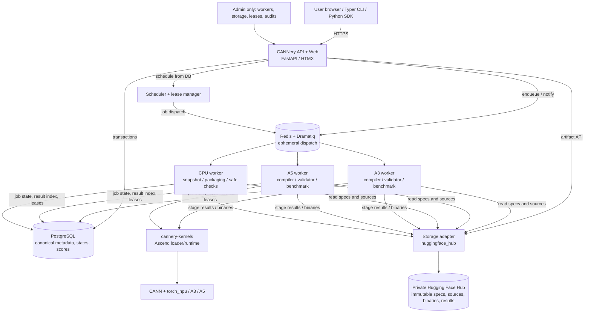
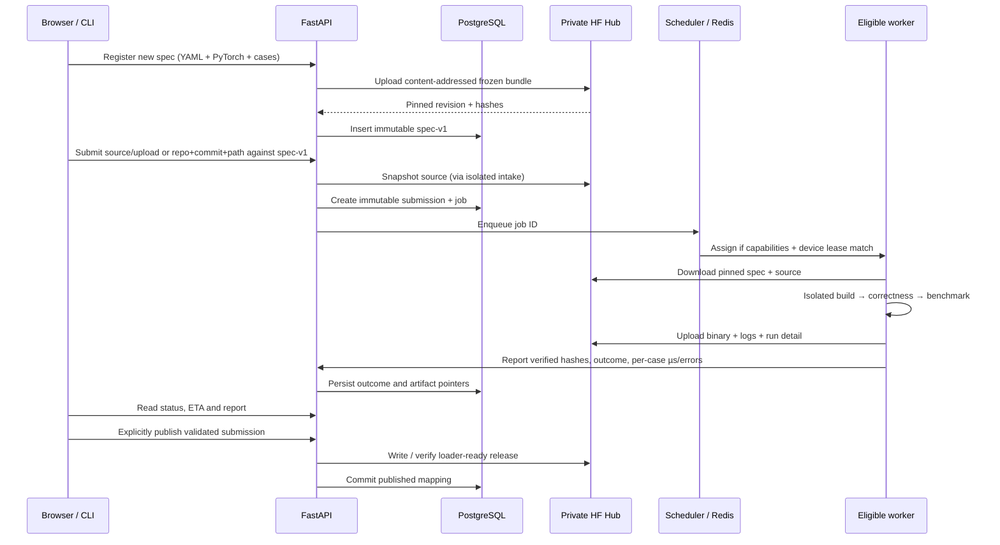

# CANNery — System Architecture

Status: proposed PoC architecture · 2026-11-09

This document defines the **deployable services**, their responsibilities and communication, **where data lands**, which data is **copied** and which is **referenced**, and how kernels move from a user's source tree to an executable Hugging Face artifact.

Read [System Design](design.md) for product semantics, [Implementation](implementation.md) for libraries and interfaces, [Roadmap](roadmap.md) for delivery, and [User Story](user-story.md) for end-to-end workflows.

## 1. Architecture at a glance



**Logical connections:** workers normally access artifact storage using short-lived scoped credentials or upload/download tickets issued by CANNery. Diagram arrows to PostgreSQL represent logical persistence, not direct broad DB access from arbitrary execution sandboxes. A trusted worker coordinator performs DB/state changes or calls internal authenticated APIs. Untrusted user code runs in a separate, sandboxed process/container.

The PoC **control plane** runs as one Docker Compose deployment on a VM; NPU workers can run on separate device hosts, communicating outbound over authenticated HTTPS/TLS and a secured job transport. Deploy the worker broker behind the private network or use a worker coordinator polling API; do not expose Redis publicly.

## 2. Service inventory

| Service | Process / placement | Responsibilities | Persistent data |
|---|---|---|---|
| Reverse proxy | Control-plane VM, Caddy or Traefik | TLS, routing, upload limits | Config / certificates |
| API + website | FastAPI, Uvicorn, Jinja2, HTMX | Identity, catalog, registration, submissions, publication, download resolution, HTML | PostgreSQL via ORM |
| Registry / publication | Module in API process (PoC) | Kernel/spec lifecycle; canonical IDs; immutable release association; review | PostgreSQL |
| Upload / source intake | Restricted background worker, optionally CPU host | Ingest archives, resolve pinned Git SHA, snapshot paths, digest, validate manifest, transfer | Hugging Face artifact store, DB index |
| Scheduler | Dedicated Python process or API-coordinated task | Eligible worker matching, concurrency quotas, exclusive NPU leases, retries | PostgreSQL durable jobs/leases |
| Broker | Redis + Dramatiq | Distribute job references and retries | Transient messages only |
| Worker coordinator | Trusted Python process per host | Heartbeats, claim/ack tasks, launch isolated job, capture status | DB via authenticated API |
| Build executor | Isolated container on eligible worker | Ascend C / Triton-Ascend / CATLASS build; export reproducible binaries | Temporary scratch, then HF |
| Correctness executor | Isolated container on NPU worker | Run reference and candidate using frozen cases; record errors and tolerance decisions | Temporary scratch, then HF + DB |
| Benchmark executor | Isolated container on NPU worker | Exclusive device timing, warm-up, per-case µs, geomean | Temporary scratch, then HF + DB |
| Artifact adapter | Python library used by API/coordinator | HF uploads/downloads and later S3 API | Private HF repositories |
| Runtime | `cannery-kernels` on consumer/worker host | Resolve pinned compatible variant, load and call kernel module | Local cache only |
| Metadata DB | PostgreSQL | Source of truth for entities, immutable hashes, jobs, results, publication, auth/audit | Backed-up DB volumes |
| Admin / telemetry | Role-gated routes; Prometheus optional | Workers, capacity, storage, queue, audits, health | DB; metrics retention |

Prefer merging small control-plane Python components inside one application until scaling actually requires more microservices. This is a **service boundary design**, not a requirement to deploy 12 separate containers.

## 3. Storage hierarchy: authoritative data and copies

| Data | First landing point | Canonical home | Copies / cache | Retention |
|---|---|---|---|---|
| Registered `cannery.yaml`, PyTorch `reference.py`, `cases.py`, env lock | Restricted intake staging | Immutable spec bundle on private HF; digest/URI in PG | Worker/download cache | Keep while spec/version is referenced |
| Git origin URL, full SHA, subdirectory | API submission metadata | PostgreSQL provenance | Included in artifact manifest | Permanent audit |
| Uploaded implementation source | Temporary restricted upload staging | Immutable source snapshot in HF; sha256 and URI in PG | Build/benchmark worker scratch/cache | Keep for referenced submissions |
| Git implementation checkout | Transient restricted Git intake | **Snapshot of resolved tree** on HF, not reliance on upstream Git | Worker scratch | Keep for referenced submissions |
| Compiled binary + build manifest | Build worker ephemeral scratch | Immutable binary on HF; digest/URI in PG | Consumer HF cache, local worker caches | Keep for published revisions and policy-defined retention |
| Full case inputs or generated fixtures | Spec bundle or generated in isolated test | Canonical deterministic generator + seeds; optional immutable case fixture objects on HF | Per-run scratch | Versioned with spec/suite |
| Correctness summaries | Worker job output | PostgreSQL case/profile outcomes and error summaries | Raw logs / detailed JSON on HF | Preserve validity/audit evidence |
| Full raw timings and logs | Worker job output | HF run bundle; indexed summary in PostgreSQL | Temporary worker scratch | Policy based; published runs retained |
| Current queue/job state | API and worker coordinator | PostgreSQL durable state | Redis messages | Job/audit retention policy |
| Worker capabilities / leases | Registration heartbeat | PostgreSQL, heartbeat time-limited | Redis delivery reference only | Current + audit history |
| Artifact bytes on user machine | HF download | User-local cache is a **copy**; HF remains canonical | `~/.cache/huggingface` default | User-controlled |
| Authentication secrets | Secret manager/env injection | Secret manager | Process memory only | Rotated; never stored in artifact manifests |

**Key invariant:** a Git commit is provenance, **not** artifact availability. We must snapshot the actual files required for evaluation, including declared dependencies and source manifests. Repository deletion or access revocation must not invalidate published kernels.

**Data copied vs referenced:** PostgreSQL stores identity, content hashes, URIs, results and small queryable aggregates, not binaries. Hugging Face stores the bytes. Redis carries IDs, never entire source archives. Workers download verified snapshots into temporary isolated workspaces, create build/results bundles, upload them, commit their DB references, and garbage-collect local scratch. User machines download/cache published artifacts independently.

## 4. Proposed Hugging Face storage layout

Prefer an organization-controlled private HF repository per registered operator **for release artifacts** in the PoC, provided kernel-repository permissions and runtime support are confirmed. General private **model** repos are an acceptable initial staging store; `kernels.get_kernel()` must ultimately read a supported kernel repository layout/type. We cannot assume an ordinary private model repo can be loaded directly by `get_kernel()`.

Example conceptual object hierarchy:

```text
HF private organization
  cannery-specs-fa-xxx/                    # private staging: model repo or other permitted type
    spec-v1/<spec-digest>/
      cannery.yaml
      reference.py
      cases.py
      environment.lock
      manifest.json
  cannery-sources-fa-xxx/                  # private staging for all candidates
    submissions/<submission-id>/
      source.tar.gz
      submission.yaml
      provenance.json
      checksums.json
  cannery-runs-fa-xxx/                     # private evaluation evidence
    <run-id>/
      correctness.json
      case-timings.json
      raw-timings.json.zst
      logs.txt.zst
  <HF-kernel-release-repo>/                # Hugging Face kernels-compatible release
    <supported loader-specific manifest, Python module, binaries>
```

These represent **logical** paths, not a commitment to create those exact repository names or types. For immutable references, record the **resolved HF commit SHA** and SHA-256 artifact digests in PostgreSQL; a moving `main` or major-version branch is not itself an immutable release. Build an explicit CANNery release→HF repo/type/commit manifest mapping.

Do not place unpublished submissions in a public Hub repo. Public CANNery catalog visibility and Hugging Face repository visibility are separate choices: we can publish discoverability **inside the organization** while keeping the HF repo private and using scoped tokens for access. External public distribution requires an explicit visibility/policy decision.

### Publication atomicity

Hugging Face and PostgreSQL do **not** share one ACID transaction. Use a two-phase application state:
1. Upload candidate artifacts to HF and verify checksums; record an uncommitted/pending artifact row.
2. Verify the final immutable HF commit and its loader manifest.
3. Transactionally mark the CANNery release `published`, referencing the pinned HF revision.
4. If step 3 fails, leave artifacts non-discoverable and reconcile on retry. A periodic reconciler can remove orphaned staging artifacts after a safe TTL.

Changing the logical publication state must never mutate a previously published binary.

## 5. Submission / evaluation sequence



During a job, status transitions: `queued → assigned → building → validating → benchmarking → finalizing → completed`. Failure, timeout and cancellation are terminal alternatives, with new attempt IDs for retries. A user sees stage and empirical ETA, not worker IDs or queue internals.

## 6. Validation and benchmark data contract

The canonical PyTorch spec defines the function, mandatory cases and reproducible fixture generator. A submission supplies implementation source plus a requested `atol` / `rtol`; the worker independently verifies the elementwise predicate, shape/dtype contract, exceptions and nonfinite behavior. Store tolerance **profiles** as immutable versions, not merely self-declared claims. The PoC evaluates a finite set of profiles; a request for an unseen arbitrary pair starts an additional evaluation.

Case result fields include:

```json
{
  "case_id": "batch1_seq4096",
  "dtype": "bf16",
  "shape_key": "B1_H32_N4096_D128",
  "median_latency_us": 324.7,
  "p95_latency_us": 338.1,
  "baseline_median_us": 681.2,
  "speedup": 2.098,
  "max_abs_error": 0.000063,
  "max_rel_error": 0.00041,
  "closeness_passed": true,
  "repeats": 100
}
```

This is an **illustrative shape** and numbers only; actual record also includes spec digest, suite revision, profile ID, device and environment fingerprint, run ID, timestamps and a link to raw measurements. Geomean speedup is `exp(mean(log(baseline_us_i / kernel_us_i)))` across **all mandatory cases** under identical spec/device/suite/profile. No benchmark score becomes final or globally eligible while correctness is pending.

Ranking and history are per device. The performance chart shows **one** overall best-so-far step line for the selected accuracy profile, and each record event gets a point colored by its language; competing per-language lines are not the primary view.

## 7. Worker placement, privileges and security

Control-plane VM: reverse proxy + FastAPI/web + scheduler + Redis + PostgreSQL, with a backup volume or managed DB backups. Separate CPU intake/build worker if load warrants. One A3 and one A5 device worker. Worker host coordinator holds minimal scoped credentials and launches submissions in restricted containers/VMs. Benchmark containers get **only** the necessary device and filesystem access, no HF write token, no registry DB password, and no arbitrary outbound network. Host coordinator uploads outputs after checking formats and hashes.

Git ingestion is especially sensitive: restrict schemes, hosts/IP ranges and redirects to prevent SSRF; disable arbitrary Git hooks, limit clone size and submodules, enforce timeouts. Archives need path traversal prevention, file-count, depth and decompression quotas. A PyTorch reference is arbitrary Python and receives the same isolation as an implementation.

The worker scheduling algorithm matches `device_kind`, exact toolchain/runtime compatibility, language adapter availability, declared execution operation and available physical-device capacity. Acquire a lease **per device** for benchmarks. Scheduler data is persisted in PostgreSQL; Redis is a notification/dispatch layer.

## 8. Distribution and local execution

There are two independently useful interfaces:

1. **CANNery CLI / SDK** resolves a published submission ID or the current winning implementation for a kernel/device/tolerance. Local capability detection picks source or binary; `--no-detect` lets users explicitly choose. It returns a manifest pinned to HF repository + commit and validates checksums.
2. **Hugging Face `kernels` runtime** loads a **loader-compatible published release** using `get_kernel(repo_id, revision=<pinned-hf-commit>, backend=...)`, then calls the module's documented exported function. The Ascend backend and build/variant support are a **planned extension in `cannery-kernels`**, not currently assumed to work on A3/A5.

The existing Hugging Face `get_kernel` API accepts `repo_id`, `revision` or `version` (mutually exclusive), `backend`, and remote-code trust controls. The existing `huggingface_hub.snapshot_download` supports pinned revision and local cache. See:
- https://huggingface.co/docs/kernels/en/api/kernels
- https://huggingface.co/docs/huggingface_hub/en/guides/download

Use a **pinned revision** in production, not a moving branch. Calling remote Python from a repository requires an explicit trust/security policy. Never silently set `trust_remote_code=True` for all global results.

## 9. Infrastructure resources and data growth

PoC starting point:
- Control plane: 8 vCPU / 32 GB RAM / 100–200 GB SSD.
- PostgreSQL: ~20–50 GB initial persistent volume; backup to separate durable location.
- Redis: ~1–2 GB memory allocation subject to backlog; not durable source of truth.
- HF private artifacts: initially budget 100–500 GB; project actual size from `source_bytes + binary_bytes + run_evidence_bytes` per candidate.
- A3 worker: dedicated device host with sufficient toolchain disk (100 GB+ scratch/cache).
- A5 worker: dedicated device host with sufficient toolchain disk (100 GB+ scratch/cache).
- Optional CPU build/intake worker: 8–16 vCPU / 32–64 GB RAM.
- HTTPS access to HF or corporate-approved artifact proxy; follow corporate data governance for proprietary sources.

Storage example (illustrative): 500 submissions × 5 MB compressed source = 2.5 GB, 100 released binaries × 50 MB = 5 GB, 2,000 runs × 2 MB compressed evidence = 4 GB, excluding additional binary compatibility variants, cached toolchains and profiling traces. Plan capacity by measured retention, not fixed kernel count.

## 10. Failure and recovery rules

- **Intake upload fails:** no accepted submission; staged files expire.
- **DB commit fails after HF upload:** garbage-collect unreferenced artifact after grace period; do not expose it publicly.
- **Worker crashes:** heartbeat/lease expiry requeues an idempotent job attempt; previous raw outputs remain traceable.
- **Duplicate delivery:** DB job attempt + digest uniqueness prevents duplicate publication or score updates.
- **Benchmark fails correctness:** preserve evidence and mark failed; no public score.
- **Private HF unavailable:** queue/retry downloads/uploads without losing DB state; do not mark `published` until release is retrievable.
- **Source Git deleted:** frozen source snapshot and pinned artifact remain available.

## 11. Implementation cut-lines

**Slice A:** local source/spec archive → frozen HF snapshot → PostgreSQL record → UI.  
**Slice B:** Git commit snapshot and private submission status → worker queue/ETA.  
**Slice C:** A5 correctness + benchmarks → per-case results → owner publication → leaderboard/history.  
**Slice D:** A3 support + independently ranked results → binary packaging → pinned HF `get_kernel` path.

For exact commands, UI steps and consumption samples, see [User Story](user-story.md).
