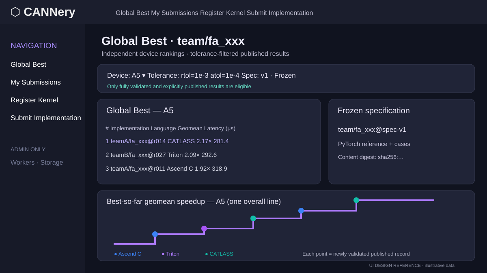
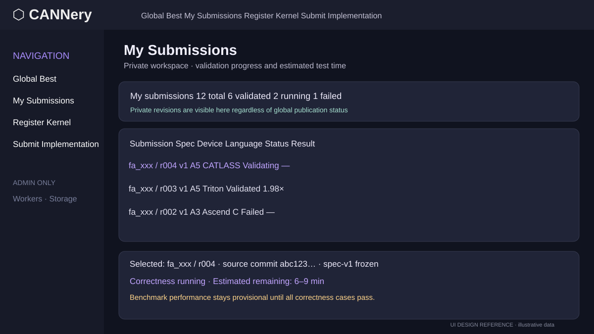
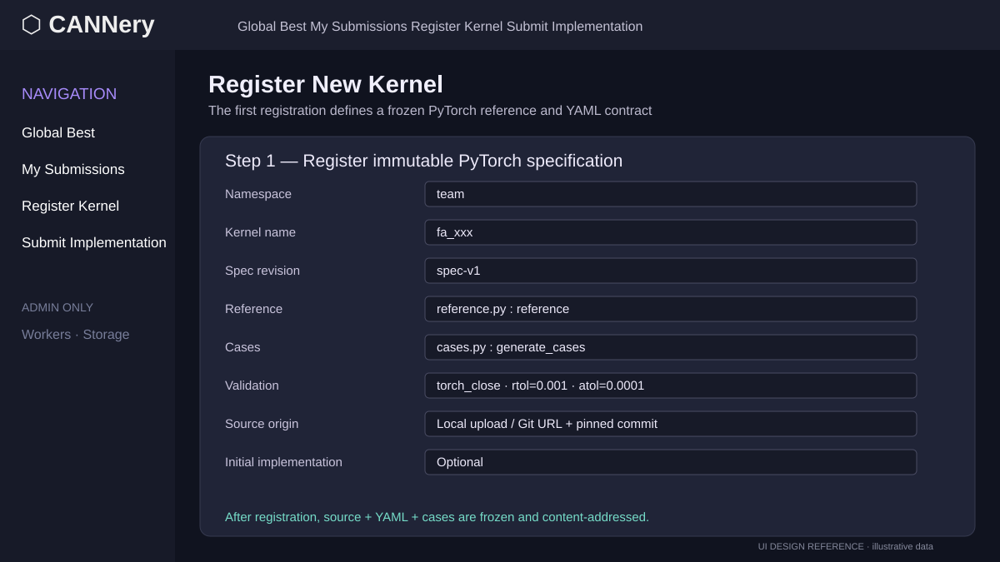
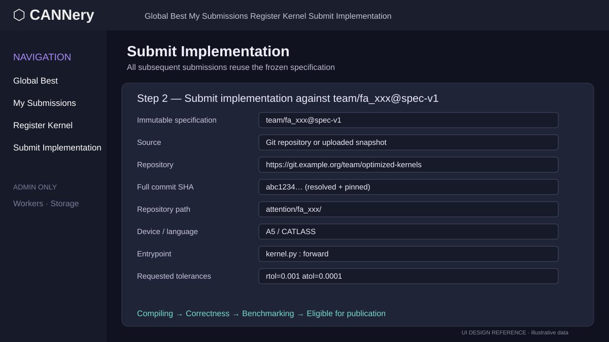

# CANNery — System Design

Status: PoC design | Updated: 2026-11-09

**Current source/build policy:** user-authored code is exclusively Git-backed; selected source trees are retained as immutable commits in internal per-kernel Git snapshot repositories. CANNery builds binary candidates during admission and stores **generated binaries** (not source snapshots) in private Hugging Face repositories. The PoC supports Ascend C and CATLASS DSL; Triton-Ascend and PyPTO follow later. See [Architecture](architecture.md), [Implementation](implementation.md), and [User Story](user-story.md).

For detailed service architecture and data movement, see [Architecture](architecture.md). For UI/programmatic submission and Hugging Face consumption examples, see [User Story](user-story.md).

## 1. Purpose and scope

CANNery is a Python-based registry, execution, benchmark, and distribution platform for **user-defined compute kernels**. Authors register an immutable PyTorch operator specification, then submit any number of implementation revisions. CANNery builds, validates, benchmarks, and optionally publishes implementations, distributing source and compatible binaries.

The PoC supports:
- CLI and website, both backed by FastAPI.
- A3 and A5 device tracks; **Ascend C and CATLASS DSL for the PoC**, with Triton-Ascend and PyPTO planned after initial delivery.
- Capability-advertising build, validation, and benchmark workers.
- Author-defined PyTorch reference functions and cases; no fixed CANNBench specification catalog.
- Two workflows: **register a new kernel** and **submit to an existing kernel**.
- Frozen PyTorch specifications and kernel source exclusively in Git, pinned by full SHA and retained as internal per-kernel Git snapshots.
- Per-case latency in **microseconds**, geometric-mean speedups, and tolerance-aware filtering.
- Global **validated + explicitly published** results, distinct from private/author submissions.
- Git-based source checkout and HF-distributed **system-built** binaries with auto-detected compatibility and explicit override.
- Private Hugging Face Hub for **generated binaries, release manifests, and benchmark evidence**, with a storage abstraction for self-hosting.
- Admin-only worker, scheduler, and storage management. Users see estimated job completion time and status, never infrastructure internals.

## 2. Repository boundaries

- [cannery](https://github.com/huawei-cpl-zurich/cannery): API, website, CLI, registry, worker daemon, build adapters, benchmark orchestration, scheduling, metadata, storage integration.
- [cannery-kernels](https://github.com/huawei-cpl-zurich/cannery-kernels): fork of `huggingface/kernels`; Ascend runtime and artifact compatibility/loader extensions. Keep fork changes minimal to facilitate upstreaming. `kernel-builder` is a separate upstream project; avoid a third fork until necessary.

A worker depends on the runtime; the API and source-only browsing/download clients need not import it.

## 3. Domain model

```text
Kernel (namespace/name)
  └── SpecificationVersion (v1, v2, ...; immutable bundle + digest)
        ├── Reference implementation (PyTorch)
        ├── Input/output contract, cases, and validation protocol
        └── ImplementationSubmission (immutable Git commit + build plan)
              ├── device track: a3 | a5
              ├── language track: ascendc | catlass (PoC); triton | pypto (later)
              ├── build artifacts: generated binary, manifest, checksums
              ├── validation runs (per case, tolerances, errors, environment)
              ├── benchmark runs (per case, µs, baseline, speedup)
              └── Publication (explicit authorization + status)
```

A kernel has a stable identity. A spec version is **content-addressed and never edited**. A semantic change to the reference, test cases, shapes/dtypes, interface, tolerance-evaluation semantics, or dependency environment produces a **new spec version**. UI descriptions and tags may be updated independently. Implementation submissions can evolve indefinitely by creating new immutable revisions.

A benchmark comparison is meaningful only for the same **spec digest, case-suite revision, device, runtime environment cohort, and tolerance profile**. Never compare A3 with A5 in a single ranking or best-so-far history.

## 4. Registration: new kernel

An author registers a new operator from a **pinned Git commit** containing YAML manifest, PyTorch reference function, and case generators. An initial Git-backed implementation is optional. Source upload from a local directory is not supported.

```text
fa_xxx/
  cannery.yaml
  reference.py
  cases.py
  implementation.py  # optional
```

Example canonical `cannery.yaml`:

```yaml
schema_version: 1
kernel:
  namespace: team
  name: fa_xxx
  description: Attention variant
spec:
  version: 1
  reference:
    file: reference.py
    function: reference
  cases:
    file: cases.py
    function: generate_cases
  interface:
    inputs: [q, k, v]
    outputs: [result]
  validation:
    metric: torch_close
    equal_nan: false
    default_rtol: 0.001
    default_atol: 0.0001
```

The registration API resolves and verifies all referenced paths, freezes the YAML, code, cases and dependency lock, computes a SHA-256 content digest, records its source provenance, and retains selected spec files in protected internal Git snapshots with PostgreSQL metadata. A source Git ref must resolve to a **full commit SHA**; tags and branches are not stable identities.

Suggested CLI:
```bash
cannery register --repo https://git.example.org/team/kernels.git \
  --commit <full-sha> --path specs/fa_xxx/
cannery register --repo https://git.example.org/team/kernels.git \
  --commit <full-sha> --path specs/fa_xxx/
```

A new spec may be created without an implementation; new spec registration has a separate review/authorization gate so an author cannot silently redefine an existing operator.

## 5. Submission: implementation of an existing spec

A subsequent submission targets a specific frozen spec and supplies implementation source, entrypoint, device, language, and requested numerical tolerances. It **cannot** override the canonical reference, cases, or test semantics.

Example `submission.yaml`:

```yaml
schema_version: 1
kernel: team/fa_xxx
spec_version: 1
implementation:
  device: a5
  language: catlass
  entrypoint: kernel.py:forward
  build:
    adapter: catlass
    inputs: [kernel.py]
    artifact: fa_xxx_a5
    options: {optimization: release}
validation:
  requested_rtol: 0.001
  requested_atol: 0.0001
```

```bash
cannery submit team/fa_xxx --spec-version 1 --device a5 --lang catlass \
  --repo https://git.example.org/team/kernels.git \
  --commit <full-sha> --path attention/fa_xxx/
```

On intake, resolve Git refs server-side, import the selected folder and declared build dependencies as a new immutable internal Git snapshot commit, verify the selected tree and manifest, then schedule a **mandatory build**. Record Git URL, resolved full commit, path, tree digest, build adapter, author and implementation lineage. **No local source uploads or HF source archives.** Generated binary candidates and build evidence are uploaded to HF storage.

M2 implements source retention and immutable revisions, ending at `awaiting_build`
with unknown ETA. The binary build, numerical evaluation and publication workflows
below describe later milestones. See [implemented submission usage](submissions.md).

## 6. Correctness, tolerance and scoring

Use the canonical PyTorch reference as the oracle. Validation executes the same cases and input fixtures for reference and candidate, on an isolated compatible worker. Default predicate follows PyTorch closeness semantics:

```text
abs(candidate - reference) <= atol + rtol * abs(reference)
```

Authors submit *requested* tolerances; CANNery independently records measured error. Persist per-case max absolute error, well-defined relative error with near-zero policy, RMS statistics, nonfinite counts, predicate outcomes, toolchain versions, and case coverage. Reject missing outputs, crashes, NaNs (unless explicitly allowed), incorrect shapes, and any failed mandatory case. Author cases may be augmented by service-owned/adversarial cases.

Tolerance filtering: an implementation is eligible only if it has passed an evaluation that **proves** the viewer's requested `rtol/atol` bounds. An author's claimed tolerance and the pair of max-error statistics alone do not prove the compound elementwise predicate for arbitrary pairs. PoC supports a **finite versioned set of tolerance profiles**, storing pass/fail for each evaluated profile. New arbitrary profiles require revalidation (or a future compact error-envelope representation). A requested profile must not silently reuse a looser test result.

For each mandatory case i, store device-measured median latency in **µs**, p95, repetition count and a pinned PyTorch or approved baseline latency. Compute `speedup_i = baseline_us_i / kernel_us_i`. The score is `exp(mean(log(speedup_i)))` over **all mandatory cases**, with completeness, correctness, and identical suite/device/tolerance enforced. Never compute geomean of latency values as the primary score.

Benchmark results are **provisional** during compilation/correctness/benchmark processing. Only completed, validated runs may show authoritative scores. Reports retain case-level measurements and raw timings for auditability.

## 7. Publication, authorization and leaderboards

Separate states:
- **Submission**: queued, assigned, compiling, validating, benchmarking, completed, failed, cancelled.
- **Validation**: pass/fail for a specific immutable evaluation run and tolerance profile.
- **Publication**: private, published, withdrawn; controlled by owner/policy.

The **Global Best** catalog consists exclusively of explicitly published, fully validated, eligible implementations. A validated candidate remains in **My Submissions** until publication is authorized. Global results are partitioned by spec version, device, test suite, and selected tolerance; the user's personal workspace includes queued, failed and private revisions.

For each device show one cumulative **overall best-so-far** step line over time. Each **new record-setting event** is marked with a point whose color identifies the winning language (Ascend C or CATLASS in PoC). Do not draw three competing language-specific best lines in the primary chart. The chart's score/timeline recomputes for the selected tolerance profile and filters to results that were published and eligible at the point in time.

## 8. User experience

User navigation: **Global Best**, **My Submissions**, **Register Kernel**, **Submit Implementation**, **Documentation**. The operator page shows frozen spec and source provenance, A3/A5 switch, tolerance selection, case-level µs, geometric-mean speedup, and best-over-time chart. Personal submissions show status, useful failure logs, ETA and a publish action after successful validation; no provisional results in the final score table.

An **Admin** route (role restricted) exposes workers, queue health, device leases, toolchains, storage usage, retry operations and audit logs. Normal users see only their job state and **estimated testing/completion time**.

### Mockups

The following vector mockups are repository-native previews. The approved high-resolution PNG mockups are distributed separately in the review bundle:

- [Global leaderboard — corrected step chart](mockups/global-leaderboard.svg): single overall best-so-far line per selected device; markers colored by language.
- [My submissions](mockups/my-submissions.svg): private candidates, validation state and ETA.
- [Register new kernel](mockups/register-kernel.svg): immutable PyTorch reference and YAML specification.
- [Submit implementation](mockups/submit-implementation.svg): Git provenance, Git commit provenance, build configuration and requested tolerances.
- [Submit implementation — validation clarification](mockups/submit-implementation.svg): provisional results until correctness finishes.

### Embedded previews









These mockups are illustrative UI concepts; implementation must follow the explicit rules above even where example artwork differs.

## 9. Service architecture

```text
CLI (Typer) / Web (Jinja2 + HTMX)
              |
          FastAPI API
      / registry / auth /
      scheduler / reporting
         /     |      \
 PostgreSQL   Redis   ArtifactStore
                  \       (private HF Hub)
                 workers (A3 / A5 / CPU)
                   |
           cannery-kernels runtime
             CANN / torch_npu
```

Worker capability documents cover A3/A5, installed CANN, torch_npu, CATLASS, supported operations (build, test, bench), accelerator count and capacity. Dispatch checks capability constraints and acquires an exclusive per-device lease for timing. Workers heartbeat and upload isolated run artifacts/results.

Artifact storage interface supports private Hugging Face repositories for generated binaries and benchmark evidence, with S3-compatible binary storage as a later alternative. Source remains in external Git plus per-kernel internal Git snapshot repositories. PostgreSQL stores the authoritative index; Redis is a job transport rather than source of truth. Binary variants include ABI/runtime constraints. Download resolution probes local capabilities by default; `--no-detect` permits explicit device/language selection but does not waive server-side execution compatibility checks. Offer a pinned Git source link when no compatible binary exists.

## 10. PoC resource envelope

For 5–15 internal users and hundreds of daily tasks: control plane VM ~8 vCPU, 32 GB RAM, ~100–200 GB SSD plus an initial 20–50 GB persistent Git snapshot volume, scaled by imported source size; one dedicated A3 worker and one dedicated A5 worker; optionally a CPU builder (~8–16 vCPU, 32–64 GB RAM). PostgreSQL 20–50 GB initially, local logs/cache 50–100 GB, private HF artifact allowance 100–500 GB depending on binary retention. Docker Compose for the control plane, isolated worker services on device hosts. Add backup/restore, quotas, credential rotation and storage retention before production.

## 11. Security and provenance

Untrusted author Python/compilers must run in sandboxed containers with restricted mounts, network egress, CPU/memory/time limits and no shared production credentials. Never execute user code in the FastAPI process. Retain selected files as internal Git snapshot commits, verify hashes, sign or attest official releases, scope HF tokens per worker/service, and distinguish private candidate builds from trusted global publications.

## 12. PoC acceptance story

An author registers `team/fa_xxx@spec-v1` from a pinned external Git commit. A second author submits an A5/CATLASS implementation referencing the frozen spec ID, pinned Git commit and build manifest. CANNery compiles it into a binary candidate, validates and benchmarks it. A capable worker runs correctness and benchmarks, records per-case µs and error; the author sees ETA and later passes/failures privately. On explicit publication, the result appears in Global Best if it satisfies the viewer's tolerance. Switching A3/A5 yields independent rankings and history. A client checks out pinned Git source or downloads a compatible HF binary, and a local Ascend runtime can load and execute the binary.

See [Implementation](implementation.md) and [Roadmap](roadmap.md).


## External Git revisions

Both new spec registration and implementation submission support sources in GitHub, GitLab, and self-hosted Git repositories, including private remotes with scoped credentials. CANNery retains **only the selected source files and declared dependencies** as immutable commits in internal Git snapshot repositories and hashes source trees. It does **not** copy author source to Hugging Face.

After an implementation's initial Git-backed submission, the normal iteration is **New revision → update commit SHA only**. The repository, path, entrypoint, frozen spec, device and language are inherited. Each commit becomes a **new immutable submission** with its own provenance, content digest, validation and benchmark history. Users can use the website, `cannery revise <submission-id> --commit <sha>`, or a REST revision endpoint. Editing the specification's Git commit produces a **new spec version** if the canonical spec changes; it never mutates an existing frozen spec.

External Git is the development source of truth; internal per-kernel Git snapshots preserve accepted source files and submission history, and Hugging Face stores compiled binaries and release artifacts. A deleted or changed upstream repository does not break accepted revisions as long as the imported internal Git snapshot is retained.

## Binary admission requirements

Each implementation commit must include a typed `submission.yaml` with `implementation.build.adapter`, declared source files, entrypoint, target and validated build options. CANNery uses an allowlisted **Ascend C** or **CATLASS DSL** adapter to compile the submitted Git tree during admission; generated binaries and build manifests are stored in private HF repositories. Build failure prevents validation and global publication. Correctness and benchmarking evaluate the **generated binary** against the frozen PyTorch spec. Users cannot upload prebuilt binaries as submissions.

```yaml
schema_version: 1
kernel: team/fa_xxx
spec_version: 1
implementation:
  device: a5
  language: catlass
  entrypoint: kernel.py:forward
  build:
    adapter: catlass
    inputs: [kernel.py]
    artifact: fa_xxx_a5
    options:
      optimization: release
validation:
  requested_rtol: 0.001
  requested_atol: 0.0001
```

CATLASS ahead-of-publication binary export must be verified against the concrete compiler/runtime API. If a specialization cannot be built into a loadable artifact, CANNery must report it as unsupported rather than silently distributing a source-only JIT kernel. **Triton-Ascend and PyPTO build adapters are future work**. Source links expose Git URL, SHA and path; binary links expose pinned HF revision and compatibility metadata.
